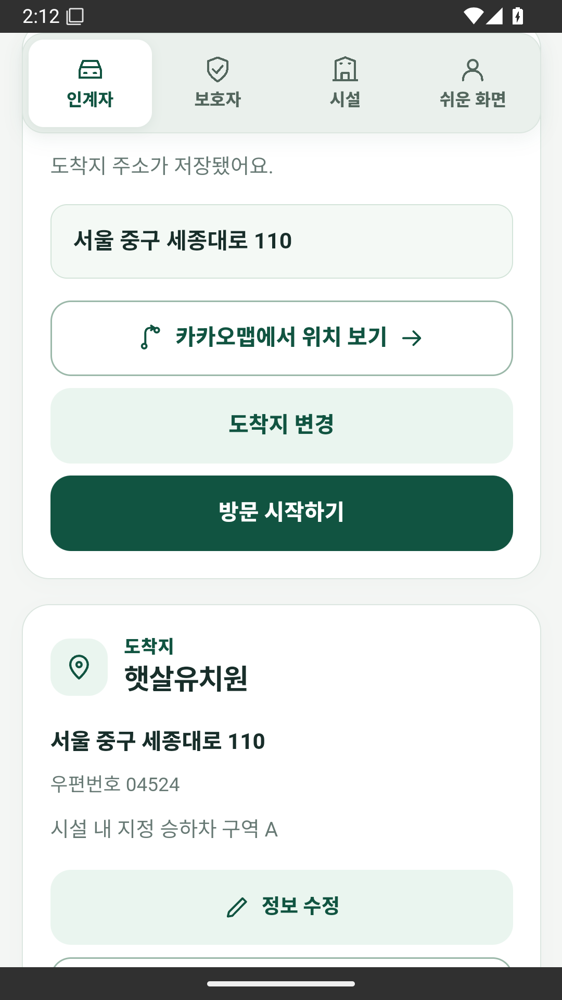
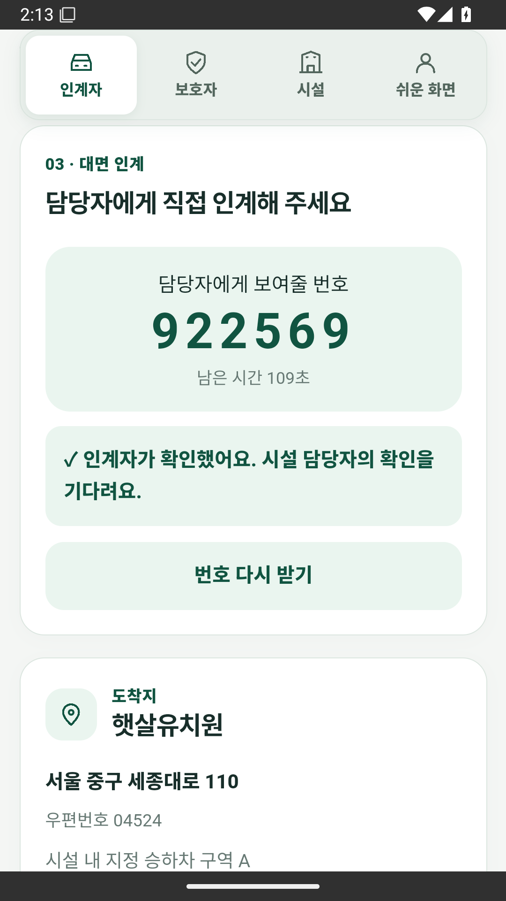
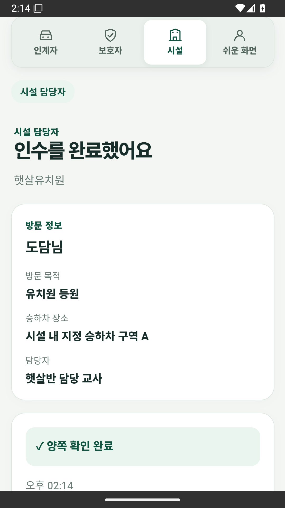
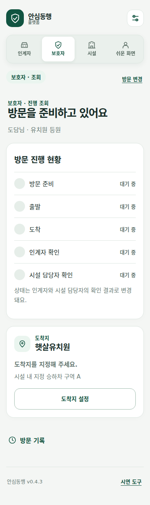
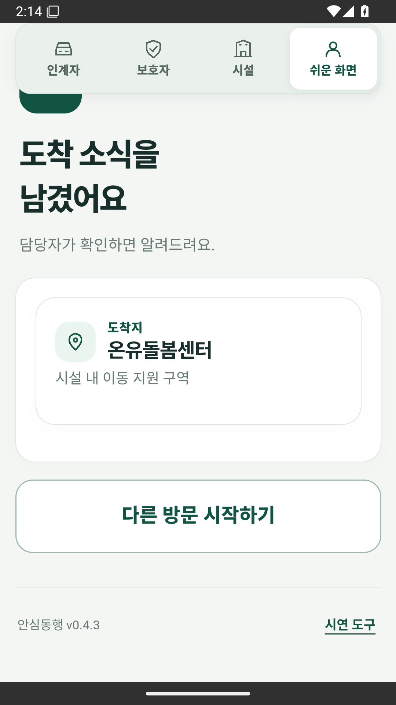
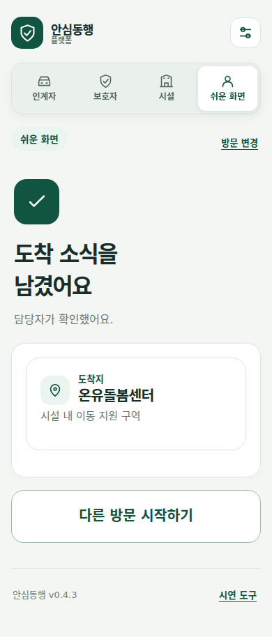

# PoC 실제 화면 증거

출발 준비에서 양측 인계, 보호자 조회, 쉬운 도착 알림까지 화면을 확인하는 자료입니다. 제품 소스는 **8f4aaf9**, 검증은 [CI40887985855](https://github.com/CSJ-PJT/Win-Win-Challenge/actions/runs/40887985855)입니다. 아래 6장은 2026-10-29 기존 CI 산출물의 원본 PNG를 그대로 옮긴 것이며 10/30 새 촬영·시험 결과가 아닙니다.

Android 캡처는 Android15/API35 에뮬레이터의 release APK09e488aa 범위입니다. Chromium 캡처는 별도 브라우저 시험입니다. 각기 다른 시험의 화면을 한 기기에서 연속 촬영한 E2E로 표현하지 않습니다. 상태표시줄 시각은 CI 실행기 값이며 한국시간 관측 시각으로 환산하지 않습니다.

## 시연 순서와 증거

| 화면·단계 | 직접 보이는 사실 | 환경·근거 |
| --- | --- | --- |
| V01/D01 주소 복원 | 저장된 공개주소·우편번호와 방문 시작 버튼 | Android LiveAddressTest 별도 실행, 1번 |
| V02 출발·도착 | 이번 선택 6장에는 해당 순간 화면 없음 | 기존 Android UI 검사와 HTTP UI 결과에서 실행 확인 |
| V03 연결번호·인계자 확인 | 인계자만 확인, 시설 확인 대기 | Android UI, 2번 |
| F02 양측 확인 완료 | 시설 인수 완료·양쪽 확인 완료 | Android UI, 3번 |
| G01 보호자 조회 | 방문 준비, 출발·도착·양측 확인 모두 대기 | Chromium 역할 탭 시험, 4번. 완료 캡처 아님 |
| E04 도착 소식 | 담당자 확인을 기다리는 알림 결과 | Android UI, 5번. ACK 이전 |
| E04 담당자 확인 | 담당자가 확인했어요 문구 | Chromium easy-completion 별도 시험, 6번. Android ACK 캡처 아님 |

보호자의 완료 조회는 [HTTP 화면 결과](evidence/ci40887985855/http-ui-results.json)의 완료 상태 assertion과 Android DOM 시험으로 입증합니다. 선택한 보호자 PNG를 완료 화면으로 바꾸어 설명하지 않습니다. 쉬운 알림의 Android ACK는 아래 DOM 시험 로그/소스가 근거이며 6번 브라우저 PNG와 합산하지 않습니다.

## 1 방문 준비와 저장 주소 복원

서울 중구 세종대로110·우편번호04524, 도착지 변경·방문 시작하기가 보입니다. 원본은 LiveAddressTest의 04-restored-address.png입니다. [JUnit OK1, 62.042초](evidence/ci40887985855/android-address-junit.txt). 원본 03-saved-address.png는 주소 입력창에 저장 버튼이 보이는 장면이므로 이 자료에서 저장 완료 증거로 사용하지 않았습니다.

## 2 인계자 확인과 시설 확인 대기

번호와 인계자 확인 안내가 보이며 시설 담당자의 확인을 기다립니다. 이 화면만으로 양측 인계 완료를 판정하지 않습니다. 번호는 과거 합성 시연의 만료된 값입니다.

## 3 시설의 양측 인수 완료

시설 화면에 인수를 완료했어요·양쪽 확인 완료와 완료 시각이 보입니다. [Android UI 기존 결과](evidence/ci40887985855/android-ui-results.json)는 인계자 독립 확인·시설 인수·보호자 완료 조회 등 7개 항목입니다. 실제 기관 인수 기록이 아닙니다.

## 4 보호자 진행 조회 화면

Chromium 역할 탭 시험의 방문 준비 대기 화면입니다. 연결번호나 인계 확인 버튼이 보이지 않습니다. 이 장면은 보호자 역할의 UI 구성을 보여주며 인계 완료 상태·폰 알림 수신 증거가 아닙니다.

## 5 쉬운 화면의 도착 소식 등록

도착 소식을 남겼어요·담당자가 확인하면 알려드려요가 보입니다. 자기 신고 알림 등록 상태이고 양측 대면 인계 완료와 별도입니다. 이 Android 캡처에는 담당자 ACK 완료가 보이지 않습니다.

## 6 쉬운 화면의 담당자 확인 결과

Chromium standalone 합성 시험에서 담당자가 확인했어요가 보입니다. [기존 easy-completion 결과](evidence/ci40887985855/browser-easy-results.json)는 ACK·역할 왕복·새로고침 유지 등을 확인합니다. 사진은 선택 주소/연락처를 주입하기 전 ACK 결과 장면이며 실제 연락처·발신을 포함하지 않습니다.

## 화면 밖 동작과 검증 경계

Android DOM 시험은 양측 인계 후 보호자의 인계를 마쳤어요, 쉬운 알림 후 시설 ACK·쉬운 화면의 담당자가 확인했어요를 검사합니다. [원본 JUnit](evidence/ci40887985855/android-dom-junit.txt)은 **OK1/20.227초**이며 [8f4aaf9의 시험 코드](https://github.com/CSJ-PJT/Win-Win-Challenge/blob/8f4aaf93e36e4dd3ab267c09c274dedaca4057a6/android/app/src/androidTest/java/kr/co/ansimdonghaeng/DomFlowTest.java)와 함께 읽습니다. process exit0만으로 통과시킨 것이 아닙니다.

대표 HTTP 서비스 E2E의 저장·서버 재시작·쉬운 ACK 복원은 [10/30 12:02 기존 결과](../build-reports/pm-20261030/poc-service-e2e.json), 사용자 조작 순서는 [시연안](DEMO_SCRIPT.md), 화면ID·버튼/API·권한·오류는 [PoC 계약](POC_REVIEW_GUIDE.md)에 연결합니다. 기존 CI와 HTTP·브라우저·다른 APK의 수치를 합쳐 새로운 통과 수나 진척률을 만들지 않습니다.

원본 PNG6/6과 동반 로그5개는 각각 기존 artifact ZIP 멤버와 바이트가 같은지 확인했습니다. 파일명·원본 멤버·artifact ID·출처·해시는 [증거 인덱스](evidence/ci40887985855/index.json)에 있습니다. 원본을 자르거나 다시 그리지 않았습니다. 별도 휴대전화·최종 release 물리·독립 QA·실차/Pleos·운영 인증·실기관 전송·실제 push는 이 자료의 완료 범위가 아닙니다.

공식 문서 v8과 봉인r4/r5/r6는 이번에 수정하지 않았습니다. 공식 문서13쪽의 b227ca2 과거 화면 출처도 그대로 유지합니다. **내용·화면 증거 준비와 실제 제출은 별개**이며 현재 필수 서류는11/1 본인 확인·서명이 남아 있습니다.
