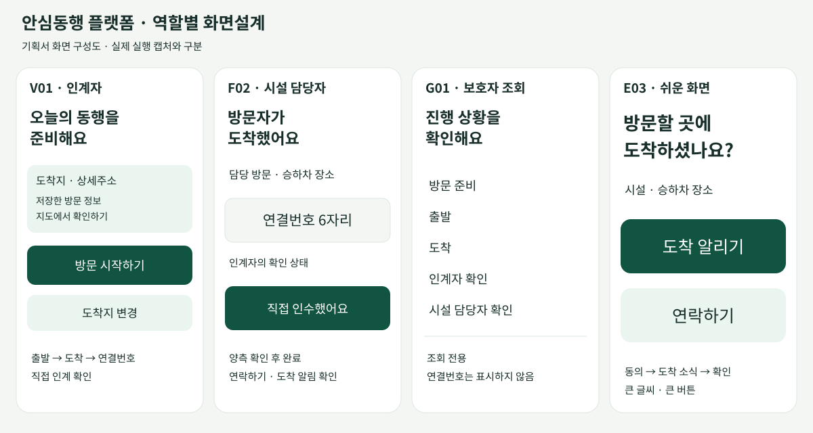
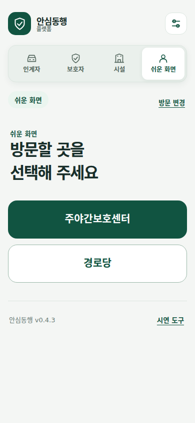
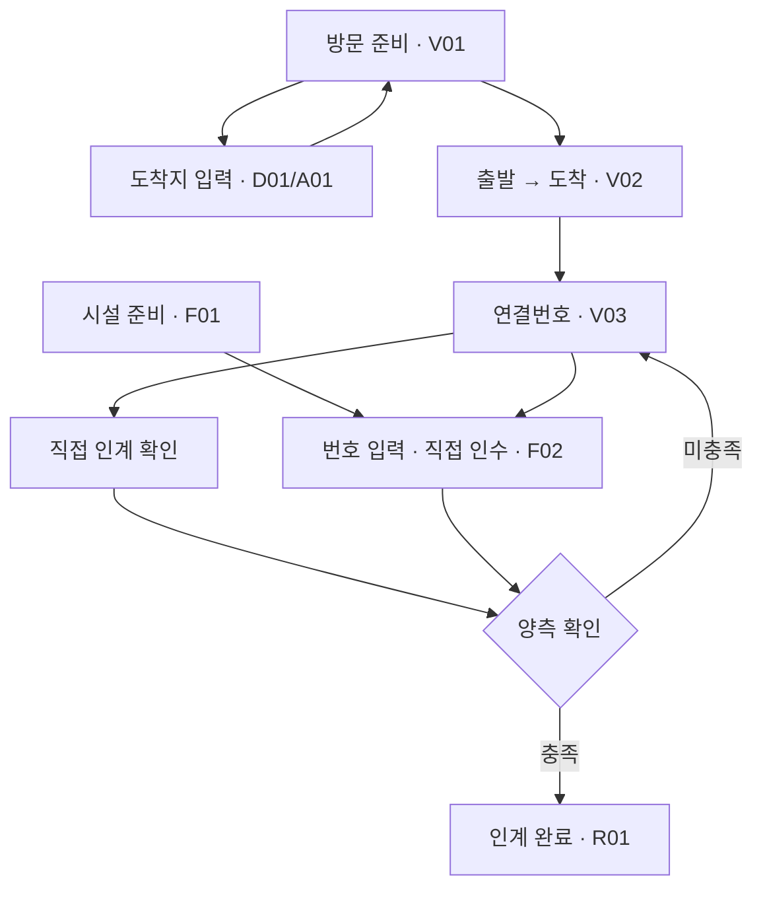
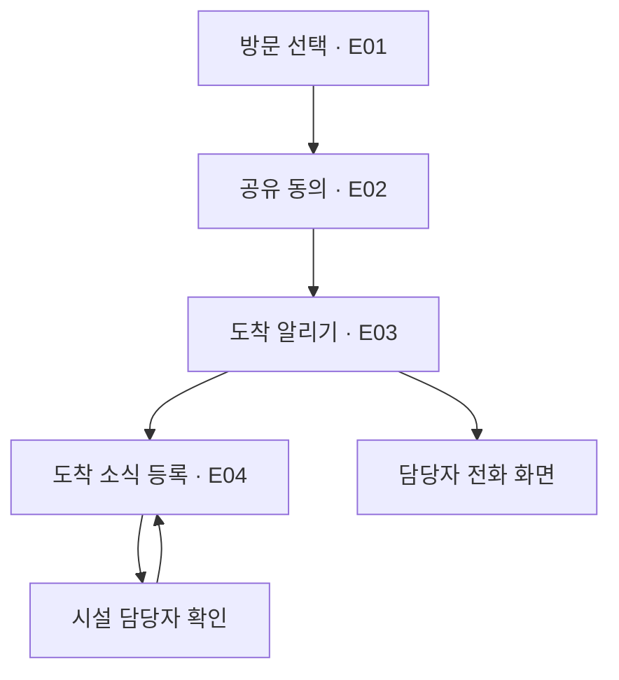

# 안심동행 플랫폼 기획서 — 화면설계

## 이용 장면

보호자·인계자는 방문지와 연락처를 준비하고 이동 상태를 확인한다. 시설 담당자는 방문자를 맞이할 준비를 표시하고, 연결번호와 대면 확인으로 인수를 기록한다. 보호자는 진행 상황을 조회한다. 어르신은 큰 버튼으로 도착 소식을 남기고 담당자에게 연락한다.

그림은 0.4.3 소스의 역할과 동작을 정리한 설계도다. 실제 실행 캡처는 `build-reports`의 버전별 검증 자료에 보관한다.

실제 브라우저 캡처: 커밋 `a001ec3`, CI `40062463496`. 역할 탭과 방문 선택 버튼의 한글 표시를 직접 확인했다. Android APK 화면의 검증과 구분한다.

## 화면 구성과 동작

| ID | 화면 | 표시·입력 | 주요 동작 | 다음 화면·연결 |
| --- | --- | --- | --- | --- |
| V01 | 인계자 · 방문 준비 | 이용자, 방문 목적, 도착지 주소·상세주소 | 도착지 입력하기·변경, 지도에서 확인하기, 방문 시작하기 | D01 → V01, 출발 후 V02 |
| D01 | 도착지 입력 | 도로명 주소, 상세주소, 우편번호 | 주소 검색, 도착지 저장 | A01 → 선택 주소 복귀; `CONFIGURE_VISIT` |
| A01 | 주소 검색 | 검색어, 공식 도로명·지번 결과 | 주소 선택, 닫기, 연결 실패 시 다시 시도 | Android `openAddressSearch` / 브라우저 `AddressPicker.mount`; D01 입력 초안 유지 |
| V02 | 인계자 · 이동·도착 | 방문지, 현재 단계, 정차·도착 조건 | 도착했어요, 연결번호 받기 | `DEPART` → `ARRIVE` → `ISSUE_CODE`; V03 |
| V03 | 인계 확인 | 연결번호, 상대방 확인 상태 | 직접 인계했어요 | `SENDER_CONFIRM`; 양측 확인 후 R01 |
| F01 | 시설 · 방문자 맞이 | 담당 방문, 이용자·승하차 장소·담당자 | 맞이할 준비 완료, 인수 어려움 | `READY`; 도착 후 F02 |
| F02 | 시설 · 인수 확인 | 연결번호 6자리, 인계자 확인 상태 | 직접 인수했어요 | `RECEIVER_CONFIRM`; 양측 확인 후 R01 |
| G01 | 보호자 · 진행 조회 | 준비·출발·도착·양측 확인 단계 | 상태 조회 | 조회 전용; 연결번호 비공개 |
| E01 | 쉬운 화면 · 방문 선택 | 주야간보호센터, 경로당 | 큰 방문지 버튼 | E02 |
| E02 | 쉬운 화면 · 공유 동의 | 방문할 시설, 도착 정보 공유 | 동의하고 계속 | `SELF_CONSENT`; E03 |
| E03 | 쉬운 화면 · 도착 알림 | 시설·승하차 장소, 담당자 연락 | 도착 알리기, 연락하기 | `NOTIFY_ARRIVAL`; E04 / 시스템 전화 화면 |
| E04 | 쉬운 화면 · 알림 결과 | 도착 소식 등록, 담당자 확인 여부 | 다른 방문 시작하기 | 시설 `ACK_ARRIVAL_NOTICE`로 확인 상태 반영 |
| R01 | 인계 결과 | 양측 확인 완료, 완료 시각 | 다음 방문 준비하기 | 새 방문 준비 |
| S01 | 방문 정보·표시 설정 | 역할별 편집 가능 정보, 글씨 크기, 지도 선택 | 저장, 닫기 | 진행 중 방문은 대상·도착지 변경 제한 |

## 화면 이동

어르신의 자기 신고 도착 알림은 대면 인계 완료와 별도 상태다. 위치 도착이나 한쪽 확인만으로 양측 인계를 완료하지 않는다.

## 상태별 화면

| 조건 | 표시·동작 |
| --- | --- |
| 도착지 없음 | 주소 입력 버튼을 제공하고 저장한 뒤 방문 준비로 돌아간다. |
| 담당자 준비 없음 | 준비가 필요함을 안내하고 연결번호 발급을 제한한다. |
| 주소 검색 연결 지연·실패 | 재시도·닫기를 제공하고 입력 중인 방문 정보는 유지한다. |
| 잘못된 번호·만료 | 불일치 또는 만료 사유를 표시하고 재확인을 요구한다. 번호 5회 오류 시 폐기한다. |
| 다른 화면이 먼저 수정 | 최신 상태를 안내하고 충돌 요청을 완료로 표시하지 않는다. |
| 연결 끊김·저장 실패 | 완료 처리하지 않고 복구 후 다시 확인할 수 있게 한다. |
| 차량 상태 불명·주행 제한 | 정차 조건을 안내하고 네이티브 조작과 인계 완료를 제한한다. |
| 빈 연락처·전화 앱 없음 | 연락 가능 상태를 확인하고 전화 실행 실패를 안내한다. |

## 어르신 화면과 접근성

쉬운 화면의 주요 버튼은 최소 높이 76px이며 큰 제목과 짧은 행동 문구를 사용한다. 글씨 확대 시 한 열 배치로 전환한다. 역할 탭은 일반·시설·보호자·쉬운 화면 간 이동을 제공하며 같은 방문 상태를 유지한다. 실제 기기의 한글 표시, 큰 글씨에서의 줄바꿈·가로 넘침, 스크롤 후 버튼 도달 여부는 화면 캡처와 APK 조작으로 검증한다.

HTTP 서버 연결 모드에서 상태·이벤트는 `/api/state`·`/api/events`로 연결한다. 단일 HTML/APK 모드는 로컬 상태 엔진을 사용하며 기관 간 클라우드 동기화를 의미하지 않는다. API별 실행 근거는 [API 검증표](API_VERIFICATION.md)에 연결한다.
